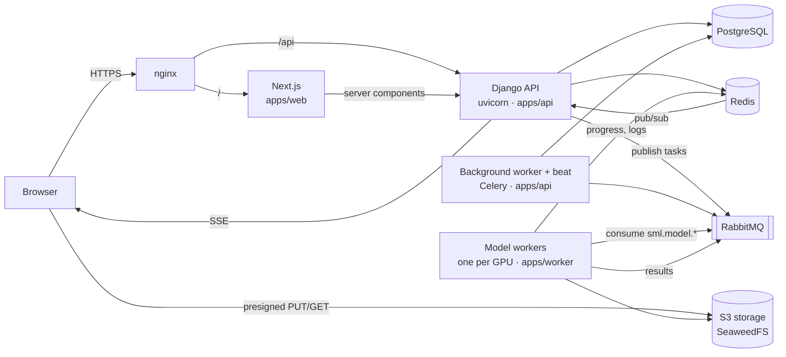

# Architecture

## Components



| Part | Responsibility |
| --- | --- |
| `apps/web` | Next.js 16 App Router UI. `proxy.ts` sets a per-request CSP nonce, gates `/app` and `/admin` on the session cookie and resolves the locale. Data comes from the typed OpenAPI client (`openapi-fetch`) through TanStack Query. |
| `apps/api` | Django 5.2 + DRF. Owns every state change: accounts, credits, jobs, billing, reports. Serves the REST API, allauth's headless auth API, the SSE stream and the hardened Django admin. |
| Background worker | Celery in the API code base: dispatching tasks, recording worker results, reports, renewals, expiry, retention. Beat runs the schedule (`sml/celery.py`). |
| `apps/worker` | Django-free Celery consumers. Runs each model script as a subprocess from its own conda env on a pinned GPU, plus metadata/C2PA analysis and the reasoning/news agents. Never touches the database. |
| PostgreSQL | System of record. |
| Redis | Cache, rate limits, live task progress and logs, pub/sub for SSE. |
| RabbitMQ | Work queues with priorities and dead-lettering. |
| S3 storage | Uploads, thumbnails, artifacts (heatmaps, face crops, annotated video), reports. Any S3 provider works. |

## A detection job, end to end

```mermaid
sequenceDiagram
  participant U as Browser
  participant A as API
  participant D as Dispatcher
  participant Q as RabbitMQ
  participant M as Model worker
  U->>A: POST /uploads (or presigned multipart for videos > 200 MB)
  A->>A: sniff type, decode, probe duration, thumbnail
  U->>A: POST /jobs/quote → credits, queue position, ETA
  U->>A: POST /jobs (Idempotency-Key)
  A->>A: reserve credits (hold) + one task per model + metadata audit
  A-->>U: 202 job (queued)
  D->>Q: publish PENDING tasks, highest priority first, per-user caps
  Q->>M: task envelope (media key, model, attempt)
  M->>M: run model script, stream progress/log to Redis
  M-->>U: progress via Redis pub/sub → SSE
  M->>Q: result (score, artifacts) → sml.results
  A->>A: record result; when all tasks are terminal → finalize
  A->>A: weighted verdict; capture or release the hold
  A-->>U: job.updated (SSE)
```

**Job states.** A job is `queued → running → succeeded | failed | canceled`. Each model is a
`JobTask` with its own state, attempt counter and log. Tasks are the outbox: the dispatcher
(`sml/jobs/dispatcher.py`) selects `PENDING` tasks under a PostgreSQL advisory lock, ordered by
priority then age, skips principals already at their in-flight cap, marks them `DISPATCHED` and
publishes after commit. A sweep every minute fails running tasks whose worker stopped sending
heartbeats (after the model's timeout plus five minutes; retried once) and tasks no worker picked
up within `STALE_DISPATCH_HOURS` (24 h), so every job settles and every credit hold is released.

**Priorities and fairness.** Plans map to queue priorities (Business > Pro > Basic > free >
guest trial; web jobs get +1 over API batches). Each principal (user, or guest device) has an
in-flight cap from its plan or access policy, so one large batch cannot occupy every GPU.

**GPU admission.** A detector task starts only when its memory fits on its worker's GPU
(`apps/worker/sml_worker/gpu.py`); until then it stays queued with "Waiting for GPU memory" while
tasks that do fit keep running. Reservations live in Redis (shared by every worker process on the
card, expiring if a worker dies) and memory used by other programs is counted. A model's need is
its observed peak plus 25 % once it has run on that media type, otherwise `gpu_mem_mb` from
`models.yaml`, capped below the card's size. A task waiting over two minutes is served first if it
can fit, so large models are not starved.

**Resident models.** Detectors with a `resident` block in `models.yaml` stay loaded: a supervisor
(`sml_worker --resident`) runs one server per heavy script in the model's own conda env on a fixed GPU,
and a `sitecustomize` hook on the task's `PYTHONPATH` hands any launch of that script to its server, which
runs it in-process with its loaders cached. Wrappers, files and scores are unchanged; without a ready
server the model loads per task, with GPU admission as above.

**Agents.** News verification and explain-why run in a separate agent worker. All runs share one
loaded Ollama model: at most `SML_AGENT_PARALLEL` at once, the rest wait; other idle models are
unloaded and the model is pinned with the same context size, so it is never loaded twice.

**Retries and fallbacks.** Worker failures are classified (`GPU_OOM`, `TIMEOUT`,
`GPU_UNSUPPORTED`, `RUNTIME_ERROR`, ...). Retryable failures get a second attempt; events from an
older attempt are ignored. A model may declare fallbacks in `config/models.yaml` (e.g. no face
found → run Center).

**Verdict and charging** (ADR 0006, 0011). Detectors are grouped by family into two analyses
(face swap, AI generation); each analysis is the weighted mean of its detectors that
produced a score, and the headline verdict is fake when any analysis is fake (it shows the highest
analysis probability). The metadata check scores the file's tags with EXIEF (`sml_worker/exief`) and
its verdict is one more weighted vote in the AI-generation analysis (confirmed 100 % fake, suspect 80 %,
weak 60 %, weight `exief_weight`, default 3); no signal, or metadata that is damaged or altered, adds
nothing. A fake verdict backed by a confirmed declaration reads "likely AI-generated". A job is
charged its quoted price only if at least one model produced a score. No-face results, failures
on our side and cancellations release the hold in full.

**Live progress.** Workers write progress and log lines to Redis (`sml:task-progress:*`,
`sml:task-log:*`, read by the admin console) and publish only a `job.activity` ping on
`sml:events:user:<id>` / `sml:events:job:<id>`; timeline events reach those channels only with their
user-facing message. The API's async SSE endpoint (`/api/v1/events/stream`) relays them; the browser
refetches the job's user view and falls back to polling when the stream is unavailable.

**What users see** (ADR 0011). `sml/jobs/public.py` is the single projection of a job for users:
generic steps, verdict reasons, provenance, check results, a combined timeline and a few
unlabelled evidence images. Reports and the AI prompts use it too; `Admin*` serializers are for
the admin API only. Queue position and ETA
come from queue depth, consumers and recent task durations (`sml/jobs/eta.py`).

## Long-form streaming (ADR 0010)

Long videos are not uploaded to storage. `apps/stream` (FastAPI, legacy `safe` conda env, GPU 2)
receives the file over a WebSocket after Django reserved credits for the selected range and
issued a signed token. It runs the legacy engines unchanged, streams per-interval results to the
browser, and reports to `POST /api/internal/streams/<id>/events` (shared key; denied by nginx).
Django keeps the scan as a normal job with its interval timeline and a preview frame, and settles
per started minute analysed; a stopped scan pays only for what ran, a failed one pays nothing.

## Credits (ADR 0005)

- A wallet holds **buckets**: each grant (signup bonus, daily free, purchase, subscription,
  promotion, admin grant) is a bucket with its own expiry.
- Spending **reserves** credits into a hold, taking from the soonest-expiring buckets first, then
  **captures** (charged) or **releases** (returned to the same buckets) when the job settles.
- Every change writes an append-only **ledger** entry. Invariant, checked in tests and by the
  reconciliation task: sum of ledger deltas = sum of remaining bucket amounts.
- Daily free credits are granted lazily on the first balance read of the business day (KST) and
  expire at midnight; unused ones never carry over. The signup bonus is granted once, after
  email verification.
- All mutations take the wallet row lock (`select_for_update`); prices are flat per file and
  admin-editable (`PriceRule`).

## Billing (ADR 0007)

Providers implement one interface (`sml/billing/providers/base.py`). Nothing is granted from
browser input: Stripe grants happen only from signature-verified webhooks whose objects are
re-fetched from Stripe; Toss payments are confirmed server-to-server with the amount taken from
our order. Webhook deliveries are de-duplicated by event id, amounts and currencies must match
the order (mismatches are flagged for review and grant nothing), and grants are idempotent per
payment. Toss billing keys for subscriptions are encrypted at rest (AES-GCM). Refunds follow the
published policy (subscriptions: full within 7 days if unused, else pro-rata; packs: unused paid
credits within 30 days; bonuses never; full refund when the fault is ours) and revoke the
remaining credits of the refunded payment.

## Security model

| Concern | Implementation |
| --- | --- |
| Passwords | Argon2id; length + breached-password (HIBP k-anonymity) checks |
| Browser sessions | allauth headless (browser client), server-side sessions, `__Host-` cookies in production, CSRF double-submit, idle/absolute/remember-me timeouts, per-session revocation |
| Second factor | TOTP, recovery codes, passkeys (WebAuthn). Every staff role requires a session verified with a second factor; the Django admin additionally requires a superuser |
| Authorization | Roles are Django groups defined in `config/roles.yaml`, carrying capability permissions checked per endpoint (`sml/core/permissions.py`); per-user access policies restrict modules, models, audit steps, in-flight tasks and retention |
| API keys | `sml_<env>_<prefix>_<secret>`, stored as HMAC-SHA256 with a server pepper, shown once; scopes, CIDR allow-list, model allow-list, expiry, rotation, usage and request logs; keys cannot reach session-only endpoints (key management, admin) |
| Abuse | Per-principal rate limits (per-key limits can only tighten them), job-creation and trial throttles, Cloudflare Turnstile on signup and the trial, allauth auth rate limits |
| Uploads | Type sniffed from content, full decode (Pillow/PyAV), pixel/size/duration limits, random storage keys, private bucket with short-lived presigned URLs |
| Web | CSP with per-request nonce and `strict-dynamic`, HSTS, frame denial, no MIME sniffing, strict referrer policy, open-redirect-safe `next` parameters |
| Errors | RFC 9457 problem details with a request id; no stack traces or server details to clients |
| Audit | Append-only audit log of security and admin actions (logins, MFA changes, role/credit/price/settings changes, refunds, API keys) |
| Data rights | Personal data export and account deletion (media purged, keys revoked, billing records kept as legally required); opt-in consent for training use |

## Internationalisation

UI strings live in `apps/web/messages/{en,ko,de}.json`; a test enforces identical keys and ICU
structure across languages. The locale is a cookie (`NEXT_LOCALE`), not a URL prefix; the API
uses the account's language (or the cookie) for emails, reports and model names.

## API contract

The API schema is generated with drf-spectacular (`/api/openapi.json`, docs at `/api/docs`) and
compiled to TypeScript (`packages/contracts`, `npm run gen:api`). CI fails if the committed
contract is stale, so frontend and backend cannot drift silently.

## Where things live

| Concern | Backend | Frontend |
| --- | --- | --- |
| Accounts, roles, MFA | `sml/accounts`, `sml/core/permissions.py` | `components/auth`, `components/settings` |
| Credits | `sml/credits` | `components/sml/credit-meter.tsx`, billing page |
| Jobs, queue, live progress | `sml/jobs` | `components/detect`, `components/results`, `hooks/use-event-stream.ts` |
| Models catalog | `config/models.yaml`, `sml/catalog` | Admin → Models (`components/admin/operations.tsx`) |
| Billing | `sml/billing` | `components/billing` |
| API keys | `sml/apikeys` | `components/api-keys` |
| Admin | `sml/adminapi` | `components/admin`, `app/admin` |
| Reports | `sml/reports` | `components/modules/reports-library.tsx` |
| Worker runtime | `apps/worker/sml_worker` | — |
